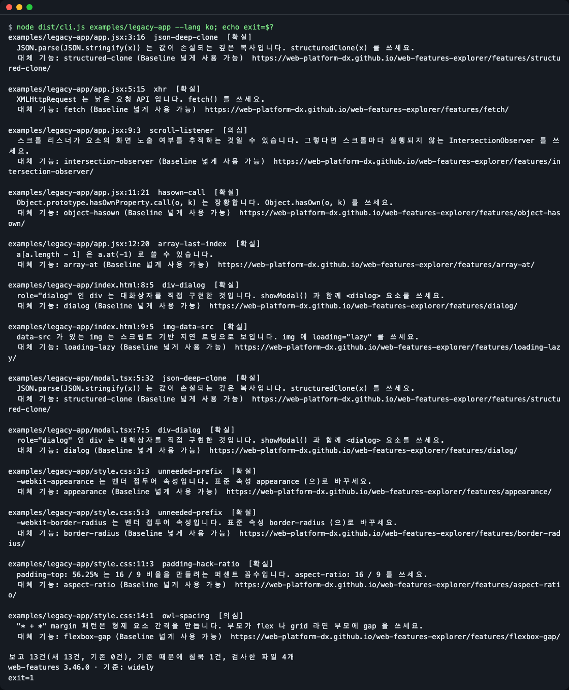
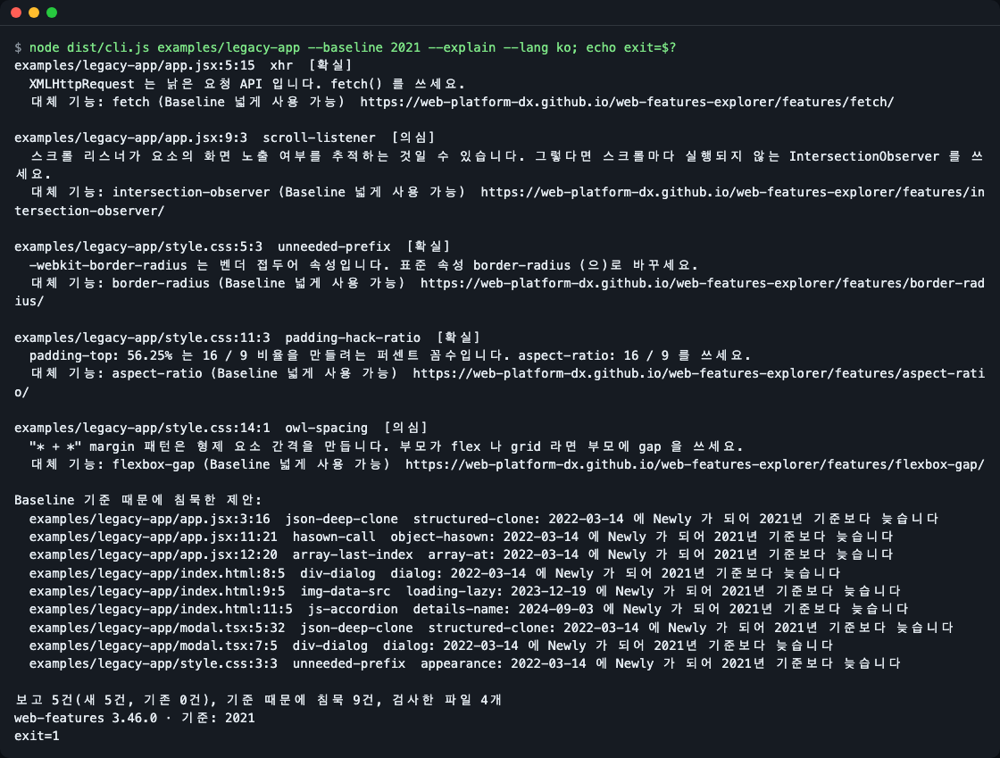
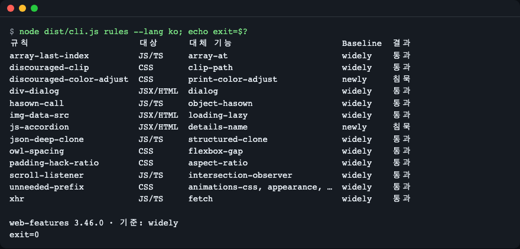
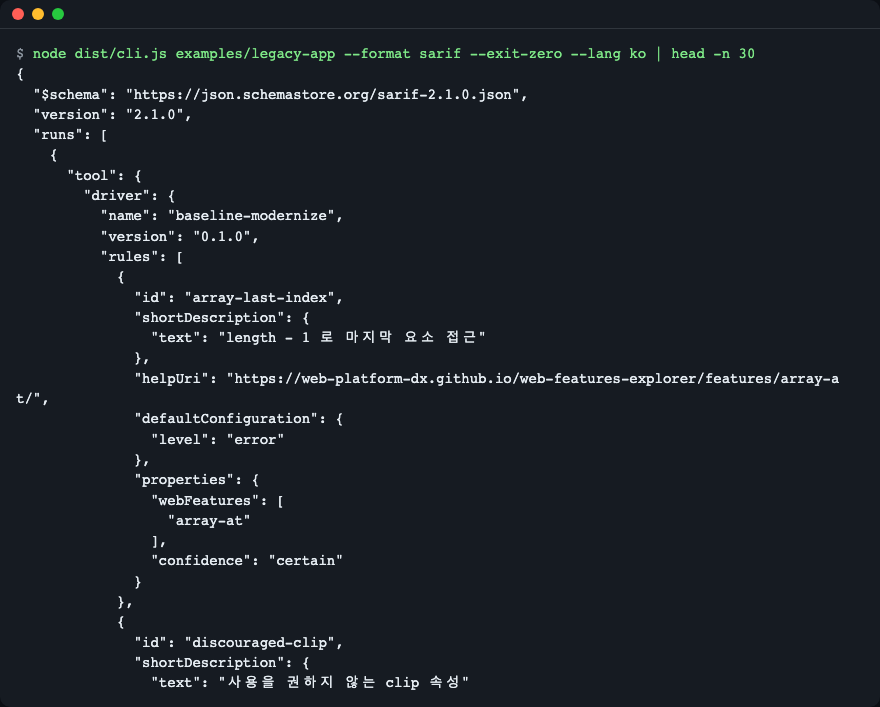
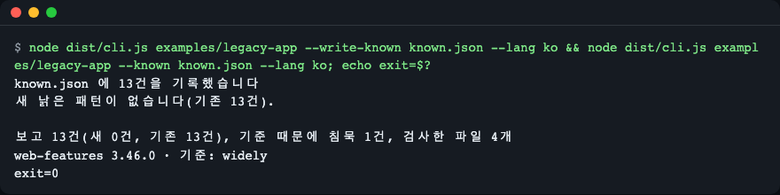

# baseline-modernize

[English](README.md) | **한국어**

JS, TS, JSX, CSS, HTML 에 남은 낡은 웹 패턴을 찾아, 내가 고른 Baseline 기준을 통과하는 현대적 대체안만 제안합니다. 파서와 고정해 둔 [web-features](https://github.com/web-platform-dx/web-features) 데이터로 동작하므로 모델도 네트워크도 필요 없고, 같은 입력이면 항상 같은 결과가 나옵니다.


*명령 한 줄로 보고마다 파일·줄·열, 확신도, 대체 기능과 그 Baseline 상태가 나옵니다. 마지막 줄에는 데이터 버전과 종료 코드가 보입니다.*

이 저장소의 `examples/legacy-app/` 폴더는 연습용으로 직접 작성한, 일부러 낡게 쓴 코드입니다.

## 왜 필요한가

코딩 에이전트와 오래된 튜토리얼은 `JSON.parse(JSON.stringify(x))`, `XMLHttpRequest`, `<div role="dialog">`, `-webkit-` 접두어, `padding-top: 56.25%` 를 계속 만들어 냅니다. 지금은 이 모두에 대응하는 표준 기능이 있습니다. 줄마다 브라우저 지원표에서 "이제 바꿔도 되나?"를 찾는 일은 느리고, 에이전트에게 긴 안내 문서를 읽히면 토큰이 들고 결과가 매번 달라집니다.

공사 현황표를 들고 다니는 점검원을 떠올려 보세요. 동네에 도시가스가 다 들어왔으면 연탄 보일러를 바꿔도 된다고 알려 줍니다. Baseline 이 그 현황표입니다. 주요 브라우저에서 어떤 웹 기능이 동작하는지 알려 줍니다. 이 도구는 현황표를 대신 읽고, 내가 고른 수준에서 이미 "준공된" 대체안만 제안합니다.

대부분의 Baseline 린터는 반대 방향입니다. 너무 새로운 기능을 쓰면 경고합니다. 이 도구는 낡은 패턴을 찾아 더 새로운 대체안을 제안합니다.

## 설치

Node.js `^20.19.0 || >=22.12.0` 과 git 이 필요합니다. Node 는 `brew install node`(macOS), 사용하는 패키지 관리자, 또는 [nvm](https://github.com/nvm-sh/nvm) 으로 설치합니다. 최소 리눅스 이미지에는 Node 와 git 만 있으면 되고, 네이티브 빌드 단계는 없습니다.

```bash
git clone https://github.com/LeeGyeongPil/baseline-modernize
cd baseline-modernize
npm install
```

`npm install` 은 TypeScript 컴파일까지 합니다(`prepare` 가 빌드를 실행). 패키지가 npm 에 게시된 뒤에는 clone 없이 실행할 수 있습니다.

```bash
npx baseline-modernize src
```

출력이 있는 아래 명령은 clone 안에서 `node dist/cli.js` 로 실행합니다. npm 패키지가 공개되면 `npx baseline-modernize` 에 같은 인자를 쓰면 됩니다.

## 빠르게 시작하기

```bash
npm start
```

`npm start` 는 연습용 폴더 `examples/legacy-app` 을 검사하고 항상 종료 코드 0 으로 끝납니다. 출력 언어는 로케일을 따르며 `--lang en|ko` 로 고를 수 있습니다. 모든 옵션은 `node dist/cli.js --help`, 버전은 `-v` 로 확인합니다. CI 가 보게 될 종료 코드를 보려면 직접 실행합니다.

```bash
node dist/cli.js examples/legacy-app --lang ko; echo exit=$?
```

보고 하나는 이렇게 생겼습니다(전체 출력의 마지막 부분).

```text
examples/legacy-app/style.css:11:3  padding-hack-ratio  [확실]
  padding-top: 56.25% 는 16 / 9 비율을 만들려는 퍼센트 꼼수입니다. aspect-ratio: 16 / 9 를 쓰세요.
  대체 기능: aspect-ratio (Baseline 넓게 사용 가능)  https://web-platform-dx.github.io/web-features-explorer/features/aspect-ratio/

examples/legacy-app/style.css:14:1  owl-spacing  [의심]
  "* + *" margin 패턴은 형제 요소 간격을 만듭니다. 부모가 flex 나 grid 라면 부모에 gap 을 쓰세요.
  대체 기능: flexbox-gap (Baseline 넓게 사용 가능)  https://web-platform-dx.github.io/web-features-explorer/features/flexbox-gap/

보고 13건(새 13건, 기존 0건), 기준 때문에 침묵 1건, 검사한 파일 4개
web-features 3.46.0 · 기준: widely
exit=1
```

- `파일:줄:열 규칙-ID` 는 위치와 어떤 규칙이 걸렸는지입니다.
- `[확실]` 은 패턴이 분명한 경우, `[의심]` 은 낡은 패턴일 때가 많지만 오탐일 수도 있으니 코드를 먼저 읽어 보라는 뜻입니다.
- `대체 기능:` 은 [web-features](https://web-platform-dx.github.io/web-features-explorer/) 기능 ID, Baseline 상태, 링크입니다.
- `기준 때문에 침묵 1건` 은 패턴은 찾았지만 대체 기능이 아직 내 기준을 통과하지 못해 보고하지 않았다는 뜻입니다(아래 참고).

## Baseline 기준 고르기

`--baseline` 이 어떤 대체안을 제안할 수 있는지 정합니다.

| 값 | 대체 기능이 허용되는 경우 |
|---|---|
| `widely`(기본) | Baseline "넓게 사용 가능"(주요 브라우저에서 30개월) |
| `newly` | "넓게" 또는 "새로 사용 가능" |
| `2021` 같은 연도 | 그 해 또는 그 이전에 새로 사용 가능해진 기능 |

기준을 낮추면 일부 제안이 조용해집니다. `--explain` 은 침묵한 것과 이유를 보여 줍니다.

```bash
node dist/cli.js examples/legacy-app --baseline 2021 --explain --lang ko; echo exit=$?
```


*2021 기준에서는 `structuredClone`, `<dialog>` 제안이 2022년에 새로 사용 가능해졌기 때문에 침묵합니다. `Baseline 기준 때문에 침묵한 제안` 목록에 이유가 나옵니다.*

2015년부터 올해까지의 연도를 받습니다. 그 밖의 값은 오류 문구와 함께 종료 코드 2 로 끝납니다.

## 규칙

규칙은 13개입니다. 대체 기능의 Baseline 상태와 현재 기준 통과 여부를 함께 봅니다.

```bash
node dist/cli.js rules --lang ko; echo exit=$?
```


*`rules` 명령은 규칙 13개와 대체 기능의 기준 통과 여부를 보여 줍니다.*

| 규칙 | 찾는 것 | 제안 | 확신도 |
|---|---|---|---|
| `json-deep-clone` | `JSON.parse(JSON.stringify(x))` | `structuredClone` (`structured-clone`) | 확실 |
| `xhr` | `XMLHttpRequest` | `fetch` | 확실 |
| `hasown-call` | `Object.prototype.hasOwnProperty.call(o, k)` | `Object.hasOwn` (`object-hasown`) | 확실 |
| `array-last-index` | `a[a.length - 1]` | `a.at(-1)` (`array-at`) | 확실 |
| `scroll-listener` | `scroll` 이벤트 리스너 | `IntersectionObserver` (`intersection-observer`) | 의심 |
| `div-dialog` | `<div role="dialog">` (HTML·JSX) | `<dialog>` (`dialog`) | 확실 |
| `img-data-src` | 스프레드 속성이 없는 `` | `loading="lazy"` (`loading-lazy`) | 확실 |
| `js-accordion` | 스크립트로 여닫는 아코디언 마크업 | `<details name>` (`details-name`) | 의심 |
| `unneeded-prefix` | 짧은 목록의 `-webkit-`·`-moz-`·`-ms-`·`-o-` 속성 | 표준 속성 | 확실 |
| `padding-hack-ratio` | `padding-top: 56.25%` 같은 비율 꼼수 | `aspect-ratio` | 확실 |
| `owl-spacing` | `* + *` margin 간격 | `gap` (`flexbox-gap`) | 의심 |
| `discouraged-clip` | `clip` | `clip-path` | 확실 |
| `discouraged-color-adjust` | `color-adjust` | `print-color-adjust` | 확실 |

`--confidence certain` 은 `의심` 보고를 숨깁니다. `--exclude <접두어>` 는 그 접두어로 시작하는 경로를 건너뜁니다(반복 가능).

## 출력 형식

기본은 `--format text` 입니다. `--format json`, `--format sarif` 는 스크립트와 CI 용입니다.

```bash
node dist/cli.js examples/legacy-app --format sarif --exit-zero --lang ko | head -n 30
```


*GitHub 코드 스캐닝이 읽는 SARIF 2.1.0 출력입니다. 규칙마다 대체 기능의 web-features explorer 페이지 링크가 붙습니다.*

GitHub 코드 스캐닝에 보이려면 SARIF 를 파일로 쓰고 업로드합니다.

```yaml
- run: npx baseline-modernize src --format sarif --exit-zero > baseline.sarif
- uses: github/codeql-action/upload-sarif@v3
  with:
    sarif_file: baseline.sarif
```

`upload-sarif` 는 이를 위한 GitHub 표준 액션입니다. 복사하기 전에 [저장소](https://github.com/github/codeql-action)에서 현재 버전을 확인하세요. 이 YAML 은 README 를 쓰는 동안 실행해 보지 않았습니다.

## 기존 코드에 도입하기

오래된 코드에는 보고가 많습니다. 한 번 기록해 두고 새로 생긴 것만 실패시키세요.

```bash
node dist/cli.js examples/legacy-app --write-known known.json --lang ko && node dist/cli.js examples/legacy-app --known known.json --lang ko; echo exit=$?
```


*`--write-known` 뒤(`known.json 에 13건을 기록했습니다` 출력) `--known` 으로 다시 실행하면 `새 낡은 패턴이 없습니다(기존 13건).` 이 나오고, 새 보고 0건, 종료 코드 0 입니다.*

기록의 각 항목은 줄 번호가 아니라 규칙·파일·공백을 정규화한 코드 조각의 지문입니다. 보고 위에 빈 줄을 넣어도 새 보고가 되지 않습니다. 낡은 줄을 하나 더 추가하면 그 줄만 새 보고가 됩니다.

## 화면 언어

출력은 영어와 한국어를 지원합니다. 우선순위는 `--lang en|ko`, `BASELINE_MODERNIZE_LANG`, `LC_ALL`, `LC_MESSAGES`, `LANG` 순이고(비어 있지 않은 첫 값, `ko` 로 시작하면 한국어), 그 밖은 영어입니다.

```bash
BASELINE_MODERNIZE_LANG=ko node dist/cli.js rules
```

## 종료 코드

| 코드 | 뜻 |
|---|---|
| 0 | 새 보고 없음(`--exit-zero`, `--write-known` 일 때도 항상 0) |
| 1 | 새 보고 있음 |
| 2 | 사용법 오류, 없는 경로, 잘못된 Baseline 기준 |

## 데이터와 결정성

도구는 `data/baseline.json` 만 읽습니다. `web-features` 3.46.0 에서 기능 이름, Baseline 상태·날짜, 권장하지 않는 기능의 대체안, 리다이렉트만 추린 스냅숏입니다. 버전은 `devDependencies` 에 정확히 고정되어 있고, 텍스트 보고 마지막 줄에 출력됩니다. web-features 새 버전이 나오면 어떤 제안이 기준을 통과하는지 달라질 수 있으므로, 결과는 오늘 날짜가 아니라 데이터 버전에 묶입니다.

데이터를 갱신하려면 `web-features` devDependency 를 올리고 `npm run gen:data` 를 실행한 뒤 `test/golden/` 의 diff 를 검토하고 커밋합니다. 스냅숏은 Apache-2.0 데이터에서 만들어졌습니다. [THIRD_PARTY_NOTICES.md](THIRD_PARTY_NOTICES.md) 를 보세요.

## 한계

- `의심` 규칙(`scroll-listener`, `owl-spacing`, `js-accordion`)은 오탐일 수 있습니다.
- `unneeded-prefix` 는 짧은 목록의 모든 속성을 보고합니다. 표준 속성이 근처에 선언되어 있는지는 보지 않습니다.
- JS, TS, JSX, TSX, CSS, HTML 만 파싱합니다. SCSS, Vue, Svelte 는 지원하지 않고 `--fix` 도 없습니다.
- 파일 하나에 문법 오류가 있어도 실행은 멈추지 않습니다. 그 파일은 보고서의 건너뛴 파일 목록에 나옵니다.
- 데이터 스냅숏을 갱신하면 결과가 달라질 수 있습니다.
- 현재 사용자가 읽을 수 없는 파일(권한 거부, `EACCES`)이 있으면 검사가 중단됩니다. 권한을 고치거나 다른 폴더를 검사하세요.

## 비교

아래 내용은 2026-11-13 에 확인한 것이며 바뀌었을 수 있습니다.

- ESLint, Stylelint, html-eslint 의 `use-baseline` 규칙([@eslint/css](https://www.npmjs.com/package/@eslint/css), [html-eslint](https://html-eslint.org/docs/rules/use-baseline), [stylelint-plugin-use-baseline](https://github.com/ryo-manba/stylelint-plugin-use-baseline))은 Baseline 기준보다 너무 새로운 기능을 보고합니다. 이 도구는 반대로 낡은 패턴을 보고하고 더 새로운 기능을 제안합니다.
- [eslint-plugin-unicorn](https://github.com/sindresorhus/eslint-plugin-unicorn) 에는 `prefer-structured-clone`, `prefer-at` 같은 JavaScript 현대화 규칙이 있습니다. 함께 쓰면 일부 JS 규칙은 같은 줄을 보고합니다.
- GoogleChrome [modern-web-guidance](https://github.com/GoogleChrome/modern-web-guidance) 는 코딩 에이전트용 안내와 `legacy-scan` 명령을 제공합니다. 무엇을 다루는지는 해당 문서를 확인하세요.

## 자주 겪는 문제

| 증상 | 원인 | 해결 |
|---|---|---|
| 예상과 다른 언어로 출력됨 | 언어가 `LC_ALL`·`LC_MESSAGES`·`LANG` 으로 정해짐 | `--lang en` 또는 `--lang ko` 를 지정 |
| CI 에서 `exit=1` | 새 보고가 있음 | 고치거나 `--write-known` 으로 기록하고 `--known` 지정 |
| `exit=2` | 없는 경로 또는 잘못된 `--baseline` 값 | `widely`, `newly`, 2015년 이후 연도 중 하나 사용 |
| 보고가 예상보다 적음 | Baseline 기준이 침묵시킴 | `--explain` 으로 이유 확인 |
| 오래된 Node 에서 `npm install` 실패 | `engines` 가 Node 20.19 이상을 요구 | Node 업그레이드 |

## 개발·기여

```bash
npm test
```

버그·제안은 이슈로 남겨 주세요. 변경 기록은 [CHANGELOG.md](CHANGELOG.md).

## 라이선스

MIT. 포함된 데이터: [web-features](https://github.com/web-platform-dx/web-features) 스냅숏, Apache-2.0([THIRD_PARTY_NOTICES.md](THIRD_PARTY_NOTICES.md) 참고).
