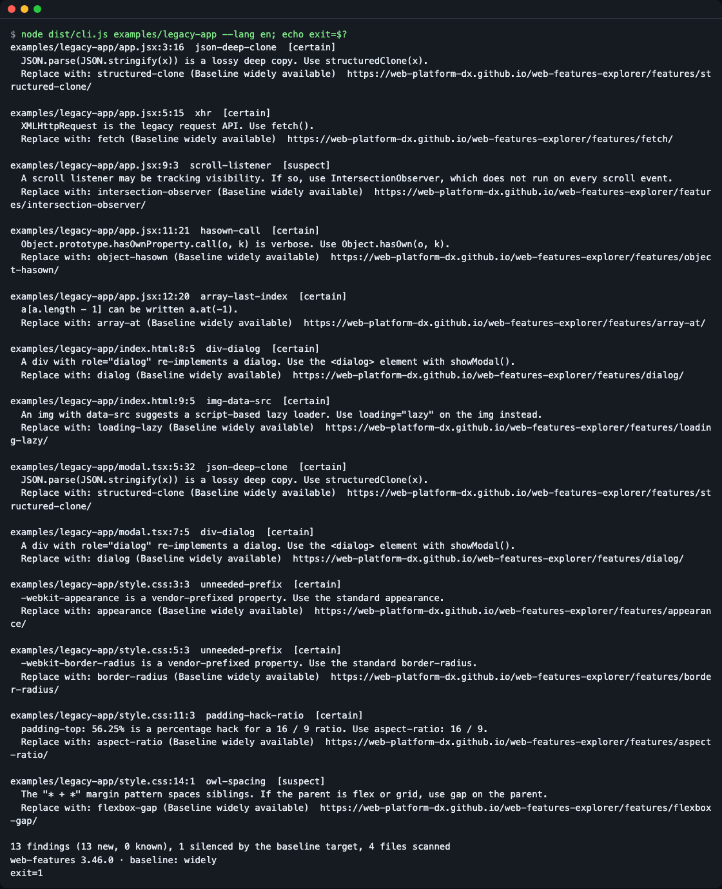
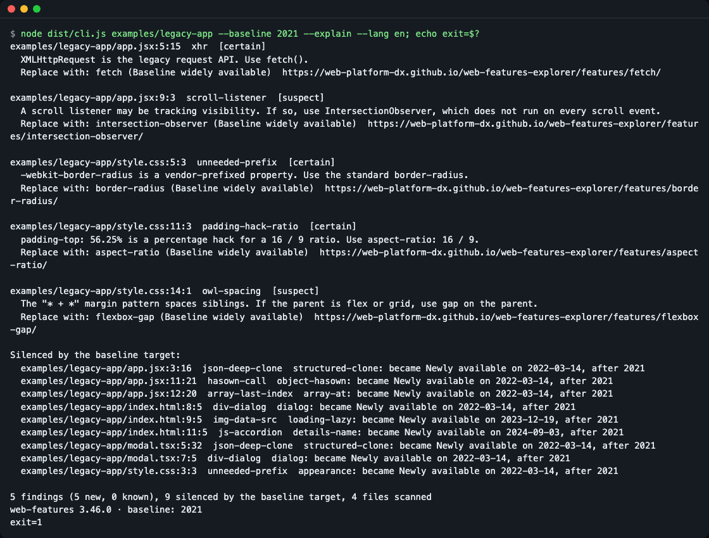
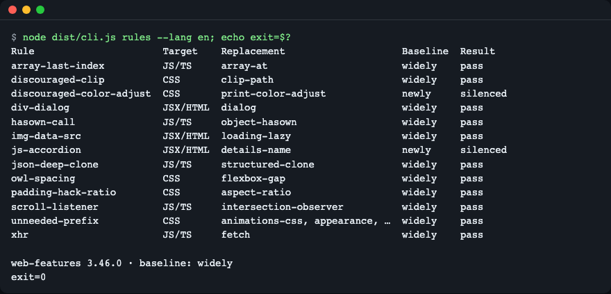
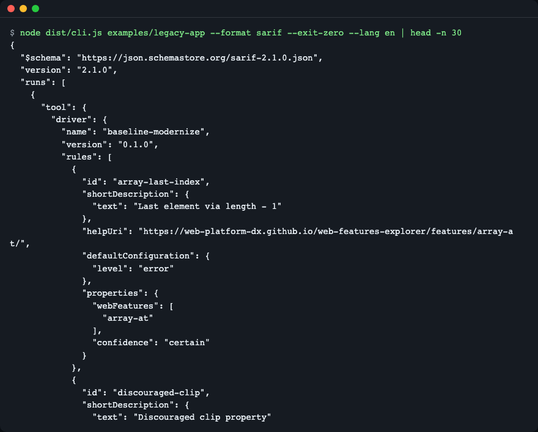
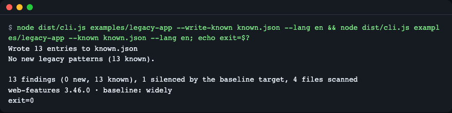

# baseline-modernize

**English** | [한국어](README.ko.md)

Find legacy web patterns in JS, TS, JSX, CSS and HTML, and suggest the modern replacement only when that replacement passes the Baseline target you choose. It runs on parsers and a pinned copy of the [web-features](https://github.com/web-platform-dx/web-features) data: no model, no network, the same input always gives the same output.


*One command lists each finding with its file, line and column, a confidence label, the replacement feature and its Baseline status. The last lines show the data version and the exit code.*

The `examples/legacy-app/` folder in this repository is hand-written, deliberately old-fashioned code used as practice input.

## Why

Coding agents and old tutorials keep writing `JSON.parse(JSON.stringify(x))`, `XMLHttpRequest`, `<div role="dialog">`, `-webkit-` prefixes and `padding-top: 56.25%`. Platform features now exist for all of these. Looking up "is it safe to switch yet?" in a browser support table for every line is slow, and asking an agent to read a long guide costs tokens and is not repeatable.

Think of an inspector with a construction-progress chart. Once gas lines reach the whole neighbourhood, the inspector tells you the coal boiler can be replaced. Baseline is that chart: it says which web features work across the major browsers. This tool reads the chart for you and only suggests replacements that are already "built" at the level you pick.

Most Baseline linters point the other way: they warn when you use a feature that is too new. This tool looks for old patterns and proposes a newer replacement.

## Install

You need Node.js `^20.19.0 || >=22.12.0` and git. Install Node with `brew install node` (macOS), your package manager, or [nvm](https://github.com/nvm-sh/nvm). A minimal Linux image only needs Node and git; there are no native build steps.

```bash
git clone https://github.com/LeeGyeongPil/baseline-modernize
cd baseline-modernize
npm install
```

`npm install` also compiles the TypeScript (`prepare` runs the build). After the package is published to npm you can run it without cloning:

```bash
npx baseline-modernize src
```

The commands with output below run inside the clone with `node dist/cli.js`. After the npm package is published, `npx baseline-modernize` takes the same arguments.

## Quick start

```bash
npm start
```

`npm start` scans the practice folder `examples/legacy-app` and always exits 0. The output language follows your locale; pick one with `--lang en|ko`. Run `node dist/cli.js --help` for all options and `-v` for the version. To see the exit code a CI job would see, run the scan directly:

```bash
node dist/cli.js examples/legacy-app --lang en; echo exit=$?
```

Each finding looks like this (the last lines of the full output are shown):

```text
examples/legacy-app/style.css:11:3  padding-hack-ratio  [certain]
  padding-top: 56.25% is a percentage hack for a 16 / 9 ratio. Use aspect-ratio: 16 / 9.
  Replace with: aspect-ratio (Baseline widely available)  https://web-platform-dx.github.io/web-features-explorer/features/aspect-ratio/

examples/legacy-app/style.css:14:1  owl-spacing  [suspect]
  The "* + *" margin pattern spaces siblings. If the parent is flex or grid, use gap on the parent.
  Replace with: flexbox-gap (Baseline widely available)  https://web-platform-dx.github.io/web-features-explorer/features/flexbox-gap/

13 findings (13 new, 0 known), 1 silenced by the baseline target, 4 files scanned
web-features 3.46.0 · baseline: widely
exit=1
```

- `file:line:column rule-id` is where it is and which rule fired.
- `[certain]` means the pattern is unambiguous. `[suspect]` means it often matches a legacy pattern but can be a false alarm, so read the code first.
- `Replace with:` names the [web-features](https://web-platform-dx.github.io/web-features-explorer/) feature ID, its Baseline status and a link.
- `1 silenced by the baseline target` means one more pattern was found, but its replacement does not pass your target yet (see below).

## Choosing a Baseline target

`--baseline` decides which replacements may be suggested.

| Value | A replacement is allowed when |
|---|---|
| `widely` (default) | Baseline "widely available" (30 months across the major browsers) |
| `newly` | "widely" or "newly available" |
| a year, such as `2021` | it became newly available in that year or earlier |

Lower the target and some suggestions go quiet. `--explain` prints what was silenced and why:

```bash
node dist/cli.js examples/legacy-app --baseline 2021 --explain --lang en; echo exit=$?
```


*With the 2021 target, `structuredClone` and `<dialog>` suggestions are silenced because they became Newly available in 2022. The `Silenced by the baseline target` list gives the reason for each.*

Years from 2015 to the current year are accepted. Anything else exits 2 with an error message.

## Rules

There are 13 rules. List them with the Baseline status of the replacement and whether it passes the current target:

```bash
node dist/cli.js rules --lang en; echo exit=$?
```


*The `rules` command lists the 13 rules and whether each replacement passes the target.*

| Rule | Looks for | Suggests | Confidence |
|---|---|---|---|
| `json-deep-clone` | `JSON.parse(JSON.stringify(x))` | `structuredClone` (`structured-clone`) | certain |
| `xhr` | `XMLHttpRequest` | `fetch` | certain |
| `hasown-call` | `Object.prototype.hasOwnProperty.call(o, k)` | `Object.hasOwn` (`object-hasown`) | certain |
| `array-last-index` | `a[a.length - 1]` | `a.at(-1)` (`array-at`) | certain |
| `scroll-listener` | a `scroll` event listener | `IntersectionObserver` (`intersection-observer`) | suspect |
| `div-dialog` | `<div role="dialog">` (HTML and JSX) | `<dialog>` (`dialog`) | certain |
| `img-data-src` | `` without a spread attribute | `loading="lazy"` (`loading-lazy`) | certain |
| `js-accordion` | script-driven accordion markup | `<details name>` (`details-name`) | suspect |
| `unneeded-prefix` | a short list of `-webkit-`/`-moz-`/`-ms-`/`-o-` properties | the standard property | certain |
| `padding-hack-ratio` | `padding-top: 56.25%`-style ratios | `aspect-ratio` | certain |
| `owl-spacing` | `* + *` margin spacing | `gap` (`flexbox-gap`) | suspect |
| `discouraged-clip` | `clip` | `clip-path` | certain |
| `discouraged-color-adjust` | `color-adjust` | `print-color-adjust` | certain |

`--confidence certain` hides the `suspect` findings. `--exclude <prefix>` skips paths that start with the prefix (repeatable).

## Output formats

`--format text` is the default. `--format json` and `--format sarif` are meant for scripts and CI:

```bash
node dist/cli.js examples/legacy-app --format sarif --exit-zero --lang en | head -n 30
```


*SARIF 2.1.0 output, the format GitHub code scanning reads. Each rule links to the web-features explorer page of its replacement.*

To show findings in GitHub code scanning, write the SARIF to a file and upload it:

```yaml
- run: npx baseline-modernize src --format sarif --exit-zero > baseline.sarif
- uses: github/codeql-action/upload-sarif@v3
  with:
    sarif_file: baseline.sarif
```

The `upload-sarif` step is the standard GitHub action for this; check its current version in its [repository](https://github.com/github/codeql-action) before you copy the line. This YAML was not run as part of writing this README.

## Adopting in an existing codebase

An old codebase will have many findings. Record them once, then fail only on new ones:

```bash
node dist/cli.js examples/legacy-app --write-known known.json --lang en && node dist/cli.js examples/legacy-app --known known.json --lang en; echo exit=$?
```


*After `--write-known` (it prints `Wrote 13 entries to known.json`), a second run with `--known` prints `No new legacy patterns (13 known).`, reports 0 new findings and exits 0.*

Each entry is a fingerprint of the rule, the file and the whitespace-normalised code, not a line number. Adding blank lines above a finding does not make it new. Adding one more legacy line makes only that line new.

## Language

Output is available in English and Korean. The order of precedence is `--lang en|ko`, then `BASELINE_MODERNIZE_LANG`, then `LC_ALL`, `LC_MESSAGES`, `LANG` (the first non-empty one; a value starting with `ko` means Korean). Anything else falls back to English.

```bash
BASELINE_MODERNIZE_LANG=ko node dist/cli.js rules
```

## Exit codes

| Code | Meaning |
|---|---|
| 0 | no new findings (also always the case with `--exit-zero` or `--write-known`) |
| 1 | new findings |
| 2 | usage error, missing path, or invalid Baseline target |

## Data & determinism

The tool reads only `data/baseline.json`, a reduced snapshot of `web-features` 3.46.0 (feature name, Baseline status and dates, discouraged alternatives, redirects). The version is pinned exactly in `devDependencies`, and the last line of every text report prints it. A new web-features release can change which suggestions pass a target, so results are tied to the data version, not to today's date.

To update the data, bump the `web-features` devDependency, run `npm run gen:data`, review the diff of `test/golden/`, then commit. The snapshot is derived from Apache-2.0 data; see [THIRD_PARTY_NOTICES.md](THIRD_PARTY_NOTICES.md).

## Limitations

- `suspect` rules (`scroll-listener`, `owl-spacing`, `js-accordion`) can be false alarms.
- `unneeded-prefix` reports every property on its short list. It does not check whether the standard property is declared nearby.
- Only JS, TS, JSX, TSX, CSS and HTML are parsed. SCSS, Vue and Svelte files are not supported, and there is no `--fix`.
- A syntax error in one file does not stop the run. The file is listed under skipped files in the report.
- Updating the data snapshot can change results.
- A file the current user cannot read (permission denied, `EACCES`) stops the scan. Fix the permissions or scan another folder.

## Comparison

Facts below were checked on 2026-11-13 and may have changed.

- ESLint, Stylelint and html-eslint `use-baseline` rules ([@eslint/css](https://www.npmjs.com/package/@eslint/css), [html-eslint](https://html-eslint.org/docs/rules/use-baseline), [stylelint-plugin-use-baseline](https://github.com/ryo-manba/stylelint-plugin-use-baseline)) report features that are too new for a Baseline target. This tool does the opposite: it reports old patterns and proposes newer features.
- [eslint-plugin-unicorn](https://github.com/sindresorhus/eslint-plugin-unicorn) has modernisation rules for JavaScript, such as `prefer-structured-clone` and `prefer-at`. If you use it, a few JS rules here will report the same lines.
- GoogleChrome [modern-web-guidance](https://github.com/GoogleChrome/modern-web-guidance) ships guidance for coding agents and a `legacy-scan` command. Check its own documentation for what it covers.

## Troubleshooting

| Symptom | Cause | Fix |
|---|---|---|
| Output is in Korean (or English) when you did not expect it | the language falls back to `LC_ALL`/`LC_MESSAGES`/`LANG` | pass `--lang en` or `--lang ko` |
| `exit=1` in CI | new findings were found | fix them, or record them with `--write-known` and pass `--known` |
| `exit=2` | missing path or invalid `--baseline` value | use `widely`, `newly` or a year from 2015 |
| Fewer findings than expected | the Baseline target silenced them | add `--explain` to see why |
| `npm install` fails on an old Node | `engines` needs Node 20.19 or newer | upgrade Node |

## Development

```bash
npm test
```

Bugs and suggestions are welcome as issues. Changes are listed in [CHANGELOG.md](CHANGELOG.md).

## License

MIT. Bundled data: a snapshot of [web-features](https://github.com/web-platform-dx/web-features), Apache-2.0 (see [THIRD_PARTY_NOTICES.md](THIRD_PARTY_NOTICES.md)).
